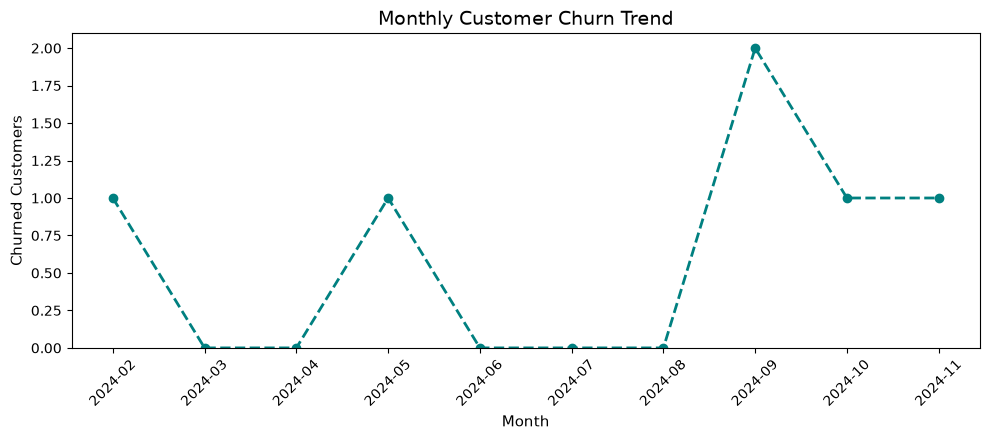
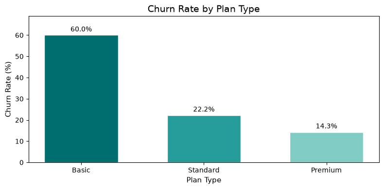
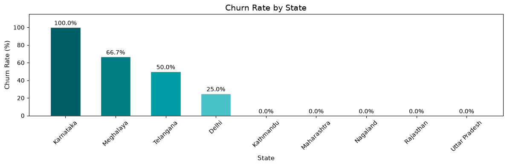
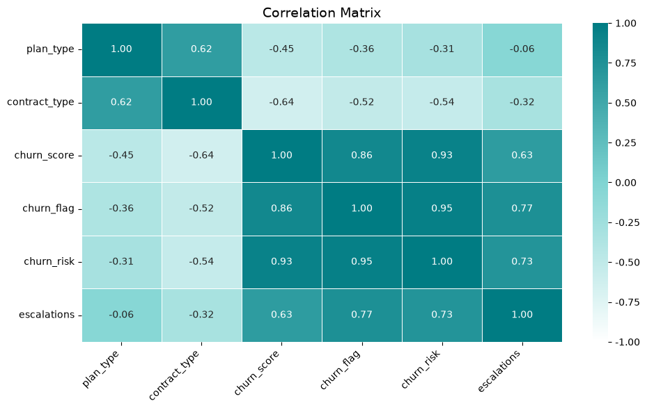
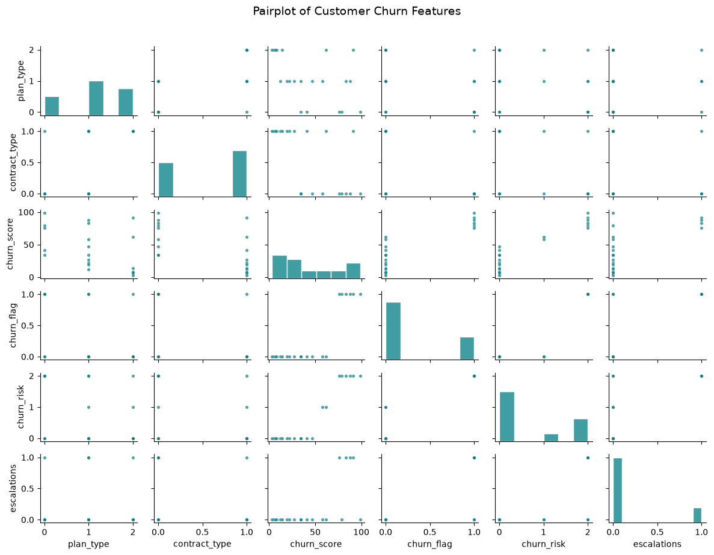
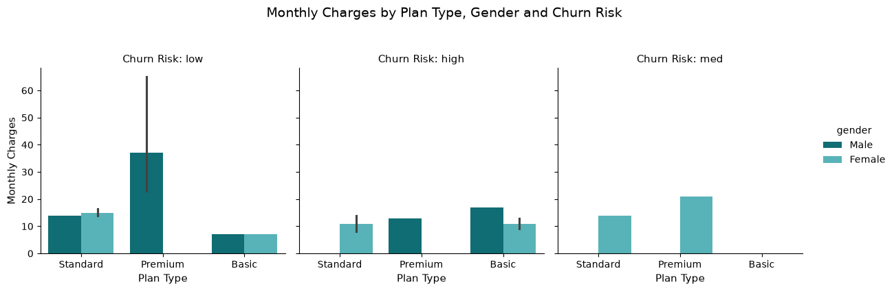

## TL;DR
This project explores customer churn using a small relational dataset containing 21 customer records, 21 subscription records, and 9 support records. I used SQLite and SQL to inspect the database tables, and Python with pandas, NumPy, Matplotlib, and Seaborn to clean and combine the data, calculate metrics, and visualize patterns.

In the sample, 6 of 21 customers have a cancellation date, giving an observed churn share of 28.57%. Churn varies across plans in this dataset: Basic is 60%, Standard 22.22%, and Premium 14.29%. These are exploratory sample results, not reliable estimates of broader customer behavior: each plan group is small, the data has no defined reporting window, and the comparisons do not establish what caused a customer to churn.

The notebook also examines monthly cancellation counts, churn by state and subscription type, customer tenure and monthly charges, support complaint and escalation records, and the supplied churn score. The “Revenue at Risk” figure is the sum of monthly charges for customers who already have a cancellation date; it is not a forecast of future revenue losses. The project is descriptive and does not train or validate a machine-learning model.

# Customer-Intelligence-and-Churn-Analysis
Exploratory customer churn analysis using SQL and Python to clean and combine customer, subscription, and support data, calculate key metrics, and visualize patterns.

## Introduction

Customer retention is an important part of understanding how a subscription business performs. This project brings together customer profiles, subscription details, and support records to explore where cancellations appear in the data and how churn patterns vary across plans, subscription types, and locations.

Using SQLite and SQL, I inspected the relational tables and loaded the data for analysis. In Python, I cleaned and prepared the fields, joined the tables, created churn-related metrics, and built visualizations with Matplotlib and Seaborn. The notebook explores overall churn and retention, customer tenure and monthly charges, cancellation counts over time, and how support records appear alongside churn.

The project uses a 21-customer sample, so its segment comparisons are exploratory. Its main focus is demonstrating a clear customer analytics workflow from relational data preparation through metric calculation and visual communication.

## Table of Contents

- [Introduction](#introduction)
- [Project Background](#project-background)
- [Key Metrics](#key-metrics)
- [Data Overview and Validation](#data-overview-and-validation)
- [Executive Summary](#executive-summary)
- [Insights Deep Dive](#insights-deep-dive)
- [Strategic Recommendations and Performance Measures](#strategic-recommendations-and-performance-measures)
- [Tools and Methods](#tools-and-methods)
- [Assumptions and Limitations](#assumptions-and-limitations)
- [Next Steps](#next-steps)
- [How to Run](#how-to-run)
- [Project Files](#project-files)
- [Data Source and Attribution](#data-source-and-attribution)

## Project Background

Subscription-based businesses rely on recurring customer relationships. When customers cancel, the business loses future billing and needs to understand where cancellations occur, which customer groups are affected, and what experiences may be associated with churn. Customer churn analysis helps organize these questions by connecting customer profiles, subscription details, and support records.

The database contains three tables connected by `customerid`: customer details, subscription details, and support records. The notebook uses SQLite to connect to the database, list its tables, and inspect their columns. It then uses Python and pandas to load, clean, summarize, and combine the data for analysis.

The notebook explores the following questions:

- What proportion of customers in the sample have a cancellation date?
- How does observed churn vary by plan type, subscription type, and state?
- What are the average monthly charges and customer tenure in the sample?
- How many cancellations are recorded in each month?
- What support records and escalation information are available for customers?

The analysis creates a churn flag from the cancellation date, summarizes support records, calculates descriptive metrics, and visualizes selected patterns. The dataset contains 21 customers, so the segment comparisons are exploratory observations from this sample.

## Key Metrics

All metrics below are calculated in Python with pandas after the notebook loads the SQLite tables. SQLite is used to connect to the database, list its tables, and inspect their columns. The notebook does not use SQL queries to calculate these metrics.

#### 1. Churn Flag

The notebook derives a binary `churn_flag` from `cancellation_date`:

- `1` if `cancellation_date` is present
- `0` if `cancellation_date` is missing

This is the outcome used in the notebook’s churn calculations.

#### 2. Overall Churn Rate

The notebook calculates the mean of `churn_flag` and multiplies it by 100:

`Churn rate = (customers with a cancellation date/customers in the analysis table) × 100.`

Six of the 21 customers have a cancellation date, so the sample churn rate is **28.57%**.

#### 3. Retention Rate

Retention is calculated as the complement of the churn rate:

`Retention rate = 100% - churn rate`

For this sample, the resulting retention rate is **71.43%**. It uses the same customer population and cancellation-date definition as the churn rate.

#### 4. Churn Rate by Segment

The notebook groups customers by `plan_type`, `state`, and `subscription_type`. Within each group, it calculates the mean of `churn_flag` and converts it to a percentage:

`Segment churn rate = (customers in the segment with a cancellation date/customers in the segment) × 100`

For plan type, the notebook reports:

| Plan | Observed churn rate |
| --- | ---: |
| Basic | 60.00% |
| Standard | 22.22% |
| Premium | 14.29% |

The state and subscription-type summaries also include customer counts. Their monthly-charge totals are sums of the available `monthly_charges` values within each group.

#### 5. Average Monthly Charges

The notebook calculates the mean of `monthly_charges` across the customer records:

`Average monthly charges = sum of monthly charges/number of customer records`

The notebook labels this metric **ARPU**. It represents the average listed monthly charge per customer record in this sample.

#### 6. Customer Age and Churn by Age Group

Age is calculated from `dob` using the date the notebook is run. Customers are placed into these age bands: Under 18, 18–30, 31–45, 46–60, and 60+.

For each band, the notebook calculates the average `churn_flag` as a percentage and counts unique customers. Because age is calculated using the run date, the age values and group assignments can change when the notebook is run later.

#### 7. Average Customer Tenure

Tenure is calculated in days using the subscription start date:

- If a customer has a cancellation date, tenure is the number of days between `subscription_start_date` and `cancellation_date`.
- If the customer has no cancellation date, tenure is the number of days between `subscription_start_date` and the date the notebook is run.

The notebook then calculates the mean of `tenure_days` across the customer records. The tenure value for customers without a cancellation date changes as time passes.

#### 8. “Revenue at Risk”

The notebook sums `monthly_charges` for customers whose `churn_flag` is `1`:

`Revenue at Risk = sum of monthly charges for customers with a cancellation date`

This is the total listed monthly charge associated with customers who have already churned. It is not a forecast of revenue from customers who may churn in the future.

#### 9. Escalation Rate

The notebook calculates the percentage of rows in the final analysis table where `escalations` equals `Y`:

`Escalation rate = rows marked Y / rows in the final analysis table × 100`

The support table can contain multiple records per customer. The notebook first calculates each customer's support-record count, then retains the latest support record per customer for the final join. As a result, this escalation percentage reflects the retained latest record for each customer, not the share of all support tickets that were escalated. Customers without a joined support record are included in the final customer table and do not match `Y`.

#### 10. Average Complaints per Customer

The notebook counts support records for each customer, then divides the total complaint count by the number of unique customers in the final analysis table:

`Average complaints per customer = total recorded support complaints / unique customers`

Customers with no support records contribute no complaints to the total but remain included in the customer denominator.

#### 11. Escalation and Churn Correlation

The notebook converts the escalation field to a binary indicator, assigning `1` to `Y` and `0` to other values, then calculates its correlation with `churn_flag`.

This is a descriptive correlation between the retained escalation indicator and churn status in this sample. It does not show that escalations cause churn.

#### 12. Churn Risk Categories

The notebook uses the provided `churn_score` field to assign categories:

| Churn score | Category |
| --- | --- |
| Below 50 | Low |
| 50 to below 70 | Medium |
| 70 or above | High |

It then calculates the mean `churn_flag` within each category and reports it as an observed churn percentage. The notebook uses a score supplied in the data; it does not create, train, or validate the score.

#### 13. Monthly Churn Trend

The notebook groups customers with a cancellation date by cancellation month and counts unique `customerid` values. It fills months with no recorded cancellations with zero and plots the result.

This chart reports the **number of recorded cancellations per month**. It does not calculate a monthly churn rate because the number of customers active and eligible to churn in each month is not included in the calculation.

## Data Overview and Validation

The analysis uses three tables from `customer_churn.db`. They are loaded into pandas and joined using `customerid`.

| Table | Purpose | Rows | Grain |
| --- | --- | ---: | --- |
| `db_customer` | Customer profile and demographic fields | 21 | One row per customer |
| `db_subscription` | Subscription details, charges, and cancellation information | 21 | One row per customer subscription |
| `db_support` | Customer support records | 9 | One row per support record |

#### Source fields

- **Customer table:** `customerid`, `name`, `country`, `state`, `gender`, `dob`, `interests`, and `pincode`
- **Subscription table:** `customerid`, subscription start and renewal dates, subscription and plan types, contract type, cancellation date and reason, monthly charges, CLTV, and churn score
- **Support table:** `customerid`, complaint date, escalation flag, CSAT score, and additional fields

#### Initial inspection

The notebook connects to the SQLite database, retrieves the table names from the database metadata, and inspects each table's column names with `PRAGMA table_info`. It then loads the tables into pandas and uses `head()`, `tail()`, and `info()` to review sample rows, data types, and missing values.

The notebook also compares row counts and distinct `customerid` counts. The customer and subscription tables each contain 21 rows and 21 distinct customer IDs. The support table contains 9 rows across 7 distinct customer IDs, so some customers have more than one support record.

#### Cleaning and preparation

The notebook makes the following changes before analysis:

- Renames `name` in the customer table to `customer name`.
- Drops `interests` and `pincode` from the customer table.
- Converts `dob` to a datetime value.
- Standardizes the gender values `Men` and `Women` to `Male` and `Female`.
- Fills missing country values using a mapping from state to country built from rows where country is present.
- Converts subscription start, renewal, and cancellation dates to datetime values.
- Drops `col_1` and `comment` from the support table.
- Converts support complaint dates to datetime values.
- Creates a support-record count for each customer, sorts support records by complaint date, and retains the latest support record per customer for the final join.
- Creates `churn_flag` from whether `cancellation_date` is populated.

#### Join and row-count checks

The notebook joins subscription records to customer records on `customerid`, then joins the support records. Before the final customer-level join, it reduces the support table to one latest record per customer. It checks table shapes and distinct customer counts to help identify row changes during merging.

This approach keeps the final analysis table at the subscription/customer level rather than allowing multiple support records to multiply customer rows. The complaint count is calculated before retaining the latest support record, so the final table can include both a total support-record count and fields from the latest retained record.

#### Validation scope

These checks are exploratory diagnostics. The notebook reviews table shapes, IDs, data types, sample rows, and missing values, but it does not implement automated assertions for all possible data-quality issues. In particular, it does not formally test every join key for unmatched records, validate all date sequences, or enforce a database schema with constraints.

The country imputation assumes that each state maps to one country. That assumption should be reviewed if the data is reused in another context. The dataset contains 21 customers and 9 support records, so findings from the cleaned and joined data remain limited to this sample.

## Executive Summary

This project examines customer churn by combining customer profiles, subscription details, and support records. SQLite is used to connect to the database, identify its tables, and inspect their columns. Python and pandas handle data preparation, joins, metric calculations, and analysis, while Matplotlib and Seaborn are used to visualize the results.

- #### Churn patterns

Six of the 21 customers have a recorded cancellation date, resulting in an observed churn rate of **28.57%** and a retention rate of **71.43%**. The plan comparison shows the highest observed churn for Basic at **60.00% (3 of 5 customers)**, followed by Standard at **22.22% (2 of 9)** and Premium at **14.29% (1 of 7)**.

Churn also varies by subscription type in this sample. The notebook reports **83.33% for Referral (5 of 6 customers)**, **16.67% for Paid (1 of 6)**, and **0% for Organic (0 of 9)**. State-level rates vary as well. For example, the notebook reports 100% for Karnataka, based on 2 customers, and 66.67% for Meghalaya, based on 3. These comparisons show how the notebook segments the data; the small group counts make the percentages sensitive to individual records.

- #### Customer and subscription metrics

The average monthly charge is **18.85** in the dataset’s units. The notebook reports average customer tenure of approximately **1,566 days**, using cancellation dates for customers who churned and the notebook run date for customers without a cancellation date. It also sums **73.94** in monthly charges for customers who have already churned. The notebook labels this value “Revenue at Risk”; in this calculation, it represents monthly charges associated with recorded cancellations.

The monthly trend chart counts cancellations by month. The plan and state charts compare churn percentages, while the subscription-type summary also reports customer counts and summed monthly charges. Together, these views provide several ways to explore the distribution of recorded churn within the dataset.

- #### Support and churn score

The support analysis reports an escalation rate of **19.05%** and an average of **0.43 support records per customer**. The escalation comparison produces a correlation of **0.77** with churn status. In the final joined table, the notebook retains the latest support record per customer, so the escalation comparison reflects those records. It describes an association in the sample and does not show that escalations cause churn.

The notebook also groups the provided `churn_score` into low, medium, and high categories and compares each category with the observed churn flag. This is a descriptive use of a source field. The project does not build or validate a churn scoring model.

### Overall takeaway

The notebook demonstrates a customer analytics workflow using relational data, Python-based preparation, KPI calculations, grouped comparisons, and visualizations. The dataset contains 21 customers and does not define a reporting observation window, so the results are exploratory and should be interpreted as patterns in this sample rather than conclusions about a broader customer population.

## Insights Deep Dive

This section explains the charts and summaries in the notebook’s analysis. The figures describe patterns in the available records. They are exploratory comparisons, not evidence that a customer attribute or support event caused churn.

#### 1. Monthly Customer Churn Trend

The line chart counts unique customers by the month of their `cancellation_date`. The recorded cancellations occur in February, May, September, October, and November 2024. September has two cancellations; each of the other four months has one.

The chart counts cancellations in each month. It does not calculate a churn rate because the notebook does not calculate how many customers were active and eligible to churn in each month.

<p align="center">
  
</p>

#### 2. Churn Rate by Plan Type

The bar chart compares the mean `churn_flag` for each plan:

| Plan | Customers | Customers with cancellation date | Observed churn rate |
| --- | ---: | ---: | ---: |
| Basic | 5 | 3 | 60.00% |
| Standard | 9 | 2 | 22.22% |
| Premium | 7 | 1 | 14.29% |

Basic has the highest observed percentage in this sample. Since each plan group is small, the percentage can change substantially with only one or two different records. The chart is useful for comparing segment churn, but it does not show that plan type explains why customers cancelled.

<p align="center">
  
</p>

#### 3. Churn Rate by State

The state chart groups the customer records by state and plots the average `churn_flag` as a percentage.

| State | Customers | Observed churn rate |
| --- | ---: | ---: |
| Delhi | 4 | 25.00% |
| Karnataka | 2 | 100.00% |
| Kathmandu | 2 | 0.00% |
| Maharashtra | 3 | 0.00% |
| Meghalaya | 3 | 66.67% |
| Nagaland | 1 | 0.00% |
| Rajasthan | 2 | 0.00% |
| Telangana | 2 | 50.00% |
| Uttar Pradesh | 2 | 0.00% |

The chart makes the variation across the recorded locations visible. The customer counts show why the percentages need care: for example, the 100% rate for Karnataka represents two customers, while the 0% rate for Nagaland represents one. The visualization does not identify a geographic cause for churn.

<p align="center">
  
</p>

#### 4. Churn by Subscription Type

The notebook groups customers by `subscription_type` and calculates the observed churn rate, customer count, and sum of monthly charges.

| Subscription type | Customers | Customers with cancellation date | Observed churn rate |
| --- | ---: | ---: | ---: |
| Organic | 9 | 0 | 0.00% |
| Paid | 6 | 1 | 16.67% |
| Refferal | 6 | 5 | 83.33% |

`Refferal` is the spelling used in the source data. The group has the highest observed churn percentage in this sample. This is a useful segment to investigate in a larger dataset, but these records alone cannot show that referral acquisition leads to churn.

The notebook also sums `monthly_charges` by subscription type. These are sums of listed monthly charges for the records in each group, not revenue collected during a defined reporting period.

#### 5. Average Monthly Charges

The notebook calculates the mean of `monthly_charges` across all customer records and reports **18.85** in the dataset’s units. It labels this value ARPU. In this notebook, it is the average listed monthly charge per customer record.

#### 6. Customer Age and Churn

The notebook calculates age from `dob` using the run date, assigns customers to age bands, and calculates churn percentage and customer count for each band. The chart is a descriptive comparison of those groups. Age values and band assignments can change when the notebook is rerun because the current date is used.

#### 7. Customer Tenure

Tenure is calculated in days from subscription start to cancellation for customers with a cancellation date. For customers without a cancellation date, the notebook uses the date it is run. The notebook reports an average tenure of approximately **1,566 days**.

This is a descriptive average across the sample. The tenure value for customers without a cancellation date increases over time, so the reported average may differ on a later run.

#### 8. Monthly Charges Associated with Churned Customers

The notebook sums `monthly_charges` for customers whose `churn_flag` is `1`, producing **73.94** in the dataset’s charge units. The notebook labels the result “Revenue at Risk.” Because the sum includes customers who already have a cancellation date, it represents monthly charges associated with recorded churn.

#### 9. Support Complaints and Escalations

The support table contains **9 support records across 7 distinct customers**. The notebook calculates a complaint count per customer before sorting the support records by complaint date and retaining the latest record per customer for the final join.

The notebook reports an average of **0.43 support records per customer** and an escalation percentage of **19.05%** in the final joined table. That escalation percentage reflects the latest retained support record for each customer. It is not the percentage of all support tickets that were escalated.

The notebook also calculates a correlation of **0.77** between the binary escalation indicator and the churn flag. This describes an association in the joined sample. It does not demonstrate that escalations cause churn.

#### 10. Churn Score and Risk Categories

The notebook uses the supplied `churn_score` to define three categories:

| Category | Score range | Customers | Customers with cancellation date | Observed churn rate |
| --- | --- | ---: | ---: | ---: |
| Low | Below 50 | 13 | 0 | 0.00% |
| Medium | 50 to below 70 | 2 | 0 | 0.00% |
| High | 70 or above | 6 | 6 | 100.00% |

The notebook compares these categories with the observed churn flag. The score is already present in the source data; this project does not create or validate it. Therefore, this comparison is descriptive and should not be presented as evidence of predictive model performance.

#### 11. Correlation Heatmap

The heatmap displays correlations among selected fields, including plan type, contract type, churn score, churn flag, churn risk, and escalations. Plan, contract, and risk categories are converted to ordered numeric codes before calculating correlations.

The heatmap is a compact way to inspect numeric associations. Correlations involving encoded categories depend on the chosen coding order, so they should not be interpreted as proof of a meaningful relationship or cause.

<p align="center">
  
</p>

#### 12. Pairplot

The pairplot shows pairwise distributions and relationships among the selected encoded fields. It can help identify visible groupings or unusual values, but with 21 customer records, individual observations can strongly affect the patterns.

<p align="center">
  
</p>

#### 13. Monthly Charges by Plan, Gender, and Churn Risk

The Seaborn categorical chart compares average `monthly_charges` by plan and gender, with separate panels for the notebook’s churn-risk categories. It provides a multi-variable view of the fields available in the sample. The chart does not measure the effect of gender, plan, or risk category on churn.

<p align="center">
  
</p>

#### 14. Pivot Tables

The notebook creates pivot tables that summarize churn by plan and combine monthly charge sums, unique customer counts, and average churn flags by plan. These tables offer a tabular view of some of the same group comparisons shown in the charts. The charge sums represent listed monthly charges, while the churn figures are proportions within the records in each plan group.

## Strategic Recommendations and Performance Measures

The notebook identifies patterns that can guide further investigation. Because the analysis uses a small sample, the recommendations below are hypotheses for a larger customer dataset, not proven retention actions.

#### 1. Investigate the Basic plan experience

Basic has the highest observed plan churn in the sample, at 60% (3 of 5 customers). Review cancellation reasons, customer feedback, pricing, and the services included with this plan. Compare the Basic experience with Standard and Premium to identify specific differences that may merit investigation.

**Measures to monitor:**

- Churn rate by plan, with the number of customers shown beside each rate
- Cancellation reasons by plan
- Monthly charges associated with churned customers by plan
- Retention by plan over a consistently defined reporting period

#### 2. Review the referral subscription segment

The source value labeled `Refferal` has an observed churn rate of 83.33% (5 of 6 customers). Before changing acquisition or retention practices, verify the category values and review the records and cancellation reasons for these customers. If the pattern persists in a larger dataset, investigate whether customers from this channel differ in onboarding, expectations, or early service experience.

**Measures to monitor:**

- Customer count and churn rate by acquisition or subscription type
- Cancellation reasons by type
- Retention at defined intervals after signup
- Monthly charges associated with cancellations by type

#### 3. Examine support experience around cancellation

The notebook finds an association between the latest retained escalation indicator and churn status. This can motivate a closer review of support experiences, but the current calculation uses the latest support record per customer and does not establish that escalation causes churn.

In a fuller support dataset, analyze all support records and compare their dates with subscription cancellation dates. This would help establish whether support activity occurred before or after cancellation.

**Measures to monitor:**

- Escalation rate across all support tickets
- Average complaint count per customer
- CSAT by escalation status
- Cancellation rate after an escalated support interaction
- Time between a support interaction and cancellation

#### 4. Track cancellations over time with a defined denominator

The notebook's monthly chart counts cancellations by cancellation month. To use this for ongoing monitoring, pair cancellation counts with the number of active customers who could have churned in each period.

**Measures to monitor:**

- Monthly cancellations
- Monthly churn rate, using a documented eligible-customer denominator
- Active customers at the start of each period
- New subscriptions and cancellations by month
- Retention by signup cohort

#### 5. Define financial measures precisely

The notebook sums monthly charges for customers who already have a cancellation date. For future reporting, define whether the business wants to track monthly charges associated with churned customers, recurring revenue lost during a period, or revenue from active customers considered at risk. These answer different questions.

**Measures to monitor:**

- Monthly charges associated with cancellations
- Recurring revenue lost in a defined period
- Active recurring revenue by plan
- Customer counts and revenue alongside each segment churn rate

#### 6. Treat the supplied churn score as an existing field

The notebook groups the source `churn_score` into low, medium, and high categories and compares them with cancellation status. It does not build or validate the score. Use the result only as a descriptive comparison unless the score's definition, timing, and performance are documented.

**Measures to review if score documentation becomes available:**

- Score definition and date calculated
- Whether score inputs were available before cancellation
- Observed churn by score band on a separate time period
- Customer counts in each score band

### Measurement approach

If a retention action is tested using a larger dataset, define the eligible customer population and measurement period before launch. Compare the outcome with a suitable baseline or comparison group, and report both customer counts and rates. Useful outcome measures include churn rate and retained recurring revenue. Guardrail measures could include discount cost, support workload, and customer satisfaction.

The current notebook does not test retention interventions or measure business impact. Its contribution is to surface questions and metrics that can be investigated with better-defined, larger-scale data.

## Tools and Methods

The notebook uses SQLite to access the project database, then performs data preparation, calculations, and visualization in Python.

#### SQLite and SQL

SQLite stores the project data in three related tables: `db_customer`, `db_subscription`, and `db_support`. The notebook connects to `customer_churn.db` with Python’s `sqlite3` library.

SQL is used to:

- Query `sqlite_master` to retrieve the database table names.
- Run `PRAGMA table_info` for each table to inspect its columns.
- Load each table into pandas with `pd.read_sql`.

The notebook does not use SQL to calculate churn metrics or perform the analytical joins. Those steps are carried out in Python with pandas.

#### Python libraries

- **pandas** loads tables into DataFrames, inspects data, converts dates, standardizes values, joins tables, groups records, calculates metrics, and creates pivot tables.
- **NumPy** creates the binary churn flag, assigns churn risk categories from the supplied score, and converts the escalation field to a numeric indicator for correlation analysis.
- **Matplotlib** creates the monthly churn trend and bar charts.
- **Seaborn** creates the correlation heatmap, pairplot, and multi-variable categorical chart.
- **sqlite3** opens and closes the SQLite database connection.

#### Data preparation

The notebook reviews table samples, data types, and missing values using pandas methods such as `head()`, `tail()`, and `info()`. It then prepares selected fields for analysis:

1. Renames the customer `name` column.
2. Drops selected customer and support columns that are not used in the analysis.
3. Converts date fields, including date of birth, subscription dates, and complaint dates, to datetime values.
4. Standardizes selected gender values.
5. Fills missing country values using a state-to-country mapping from non-missing rows.
6. Calculates each customer's support-record count and retains the latest support record for the final customer-level join.
7. Creates `churn_flag` from whether the cancellation date is present.

#### Combining and summarizing data

The subscription table is joined with customer information on `customerid`. The support data is summarized at customer level before being joined, so multiple support records do not multiply customer rows in the final analysis table.

The notebook compares table shapes and distinct customer counts before and after joining. It also groups records by plan, state, subscription type, age band, and churn-risk category to calculate sample counts, churn percentages, and selected monthly-charge summaries.

#### Metrics and analysis

The notebook calculates churn and retention percentages, average monthly charges, customer tenure, monthly charges associated with customers who have churned, support-record counts, escalation percentages, and correlations between selected fields. It also groups the supplied `churn_score` into low, medium, and high categories and compares those categories with the observed churn flag.

#### Visualizations

The notebook uses Matplotlib and Seaborn to create:

- A line chart of cancellation counts by month
- Bar charts of observed churn by plan and state
- A correlation heatmap for selected numeric and encoded fields
- A pairplot of selected encoded fields
- A categorical chart comparing monthly charges by plan and gender across churn-risk categories
- Pivot tables summarizing churn and monthly charges by plan

The charts are exploratory views of the data. They help communicate the calculations and compare groups in the sample.

## Assumptions and Limitations

The analysis reflects the fields and records available in the project database. The following assumptions affect how its metrics and charts should be interpreted.

#### Dataset size and coverage

- The customer and subscription tables each contain 21 records. The support table contains 9 records across 7 customers.
- Segment groups are small, so a small change in the records can substantially change a churn percentage.
- The data does not provide a documented reporting period or a sequence of monthly customer snapshots.
- The analysis assumes the customer and subscription tables represent the same customer population and that `customerid` is the appropriate key for combining them.

#### Churn definition and denominator

- A customer is marked as churned when `cancellation_date` is present. A missing cancellation date is treated as not churned.
- The overall churn rate uses the customer rows in the analysis table as its denominator. The notebook does not define a reporting cutoff or specify which customers were eligible to churn during a particular period.
- The monthly trend chart counts cancellations by cancellation month. It does not divide by the number of active customers in each month, so it is not a monthly churn rate.
- The source does not include customer status snapshots over time, so the analysis cannot show how the active customer population changed month by month.

#### Support records and joins

- The support table can contain multiple records for a customer. The notebook calculates a complaint count, sorts support records by complaint date, and retains the latest support record per customer for the final join.
- Escalation analysis in the final customer-level table therefore reflects the latest retained support record, not all tickets.
- Customers without a joined support record remain in the final table. When the escalation field is converted to a binary value, records that do not equal `Y`, including missing values, are assigned `0`.
- The correlation between escalation and churn is descriptive. It does not establish that escalation occurred before cancellation or caused it.

#### Metric assumptions

- **Average monthly charges:** The notebook calculates the mean of `monthly_charges` and labels it ARPU. The source does not define a reporting period or currency unit for this metric.
- **“Revenue at Risk”:** The notebook sums monthly charges for customers who already have a cancellation date. It does not estimate future losses from customers who may churn.
- **State and subscription-type charge totals:** These are sums of listed monthly charges in each group, not revenue collected over a defined period.
- **Average complaints per customer:** This uses the support-record counts divided by the number of customers in the analysis table, including customers with no support record.

#### Date-based calculations

- Tenure for customers with a cancellation date is measured from subscription start to cancellation.
- Tenure for customers without a cancellation date is measured from subscription start to the date the notebook is run. The result can change when the notebook is rerun.
- Customer age is also calculated using the date the notebook is run, so age and age-band assignments can change over time.
- The country imputation fills missing values using a state-to-country mapping from available records. This assumes each state maps unambiguously to one country.

#### Supplied churn score and visual analysis

- `churn_score` is provided in the source data. The notebook groups it into low, medium, and high categories but does not document how the score was produced or validate its predictive performance.
- The correlation heatmap and pairplot use numeric encodings for selected categorical fields. Correlations involving encoded categories depend on the chosen numeric order and may not represent a meaningful relationship.
- The notebook uses descriptive summaries and visual comparisons. It does not include statistical significance testing, causal analysis, or a validated predictive model.

#### SQL scope

SQLite is used to connect to the database, list tables, and inspect their columns. Data cleaning, joins, metric calculations, and visual analysis are performed in Python with pandas and NumPy. The notebook does not contain SQL analysis queries for calculating the reported churn metrics.

## Next Steps

The current notebook provides an exploratory analysis of customer, subscription, and support data. To make the project more reliable, easier to reproduce, and more useful for business analysis, we need to strengthen the metric definitions, data checks, and documentation.

#### 1. Define the reporting period and churn population

We need to choose and document an `analysis_date` and a reporting period. We also need to define which customers belong in the population being measured and the event that qualifies as churn. This will make it clear which customers are included in each rate and when the measurement applies.

For monthly reporting, we need to identify the customers who were active and eligible to churn during each month. We can then calculate:

`Monthly churn rate = customers who cancelled during the month/customers eligible to churn during the month`

The monthly cancellation chart in the current notebook counts cancellations by month. Adding the eligible customer base would let us report a rate as well as a count.

#### 2. Add SQL analysis queries

We need to add SQL queries that answer some of the notebook's business questions directly from the SQLite database. These could include:

- Total customers and subscriptions
- Churn rate by plan, contract, and subscription type
- Cancellation counts by month
- Monthly charges associated with cancelled subscriptions
- Data-quality checks for duplicate IDs, missing values, and unmatched records

We should compare the results of these SQL queries with the corresponding pandas calculations. Matching results would provide a useful validation check and make the SQL analysis more visible in the project.

#### 3. Expand data-quality checks

We need to add a consistent set of checks before analyzing the data. These checks should confirm that:

- `customerid` is unique in tables intended to contain one row per customer.
- Customer IDs in the subscription and support tables can be matched to the customer table where expected.
- Required fields do not contain unexpected missing values.
- Categories such as plan type, contract type, gender, and escalation status use consistent values.
- Subscription start, renewal, complaint, and cancellation dates follow sensible date order.
- Monthly charges and churn scores fall within expected ranges.
- Table row counts remain as expected after each join.

We should summarize the check results in the notebook so readers can see what was checked and whether any issues were found.

#### 4. Analyze all support records

We need to preserve the full support history for ticket-level analysis instead of relying only on the latest support record for each customer. From the full support table, we can calculate:

- Number of support records per customer
- Number and percentage of escalated tickets
- Average CSAT score per customer
- Time between support contacts
- Support activity before a cancellation

We should keep ticket-level measures separate from customer-level measures. For example, escalation rate across support tickets should use tickets as its denominator, while the percentage of customers with an escalation should use customers as its denominator.

#### 5. Make age and tenure calculations reproducible

We need to define a fixed `analysis_date` near the beginning of the notebook and use it for age and tenure calculations. The current notebook uses the date it is run for customers without a cancellation date, which means those values change over time.

Using one documented analysis date will make the notebook's results stable when it is rerun with the same data. We should also state whether tenure is measured in calendar days or complete months.

#### 6. Add context to the visualizations

We need to show the number of customers behind each plan and the percentage. A churn percentage without its group size can be difficult to interpret, especially when a group contains only a few customers.

We should also:

- Label monthly cancellation charts as counts unless a denominator is included.
- Identify whether charge values are averages or totals, and state their units.
- Sort segment charts consistently to make comparisons easier.
- Document how categories are encoded in the correlation heatmap and pairplot.
- Avoid interpreting correlations involving encoded categories as direct evidence of a meaningful relationship.

#### 7. Turn observations into measurable follow-up questions

With a larger dataset, we need to check whether the patterns observed by plan and subscription type remain consistent. We should also examine whether support activity occurs before cancellation and whether the association holds across a longer period.

If a retention action is tested, we need to define the eligible customers, comparison period, and success criteria before evaluating the outcome. Measures could include:

- Churn rate during the measurement period
- Recurring charges retained
- Customer satisfaction
- Support workload
- Discount or retention-offer cost

These measures would help distinguish an observed pattern from a change associated with a specific retention action.

#### 8. Improve project reproducibility

We need to document the Python version and required packages, identify which files are inputs and which are generated outputs, and explain how to rebuild the SQLite database from the Excel workbook.

We should also make sure the notebook runs from a fresh copy of the repository. Using the same input files and fixed analysis date should produce the same tables, metrics, and charts. Finally, we need to add the source and reuse terms for the dataset before publishing the workbook or database.

## How to Run

The notebook reads data from `customer_churn.db`. Keep the database and notebook in the same project folder before running the analysis.

#### 1. Clone the repository

```bash
git clone https://github.com/AryaGadekar/Customer-Intelligence-and-Churn-Analysis.git
cd Customer-Intelligence-and-Churn-Analysis
```

#### 2. Create a Python environment

**macOS or Linux:**

```bash
python3 -m venv .venv
source .venv/bin/activate
```

**Windows:**

```bash
python -m venv .venv
.venv\Scripts\activate
```

#### 3. Install the required packages

```bash
python -m pip install pandas numpy matplotlib seaborn jupyter
```

The notebook uses Python's built-in `sqlite3` library, so it does not need to be installed separately.

#### 4. Launch Jupyter Notebook

Run this command from the project folder:

```bash
jupyter notebook
```

In the browser window, open `Customer-Intelligence-and-Churn-Analysis.ipynb`.

#### 5. Run the notebook

Run the notebook cells from top to bottom. It connects to `customer_churn.db`, inspects the tables and columns, loads the customer, subscription, and support data into pandas, and performs the data preparation, analysis, and visualizations.

The notebook saves the combined dataset as `exported_churn_data.csv` in the project folder.

### Notes

- Keep `customer_churn.db` in the same folder as the notebook. If Jupyter cannot find the database, check that Jupyter was started from the project folder.
- `customer_churn_data_raw.xlsx` is included as a source-data reference. The notebook reads from the existing database and does not rebuild it from the workbook.
- Age and tenure calculations use the date the notebook is run, so those results may change when the notebook is run later.

## Project Files

```text
Customer-Intelligence-and-Churn-Analysis/
├── Customer-Intelligence-and-Churn-Analysis.ipynb
├── customer_churn.db
├── customer_churn_data_raw.xlsx
├── exported_churn_data.csv
├── Data Analytics Project -Churn Analysis Report.pdf
└── README.md
```

### Main files

- **`Customer-Intelligence-and-Churn-Analysis.ipynb`**  
  The main project notebook. It connects to the SQLite database, inspects the available tables and columns, loads the data into pandas, prepares and combines the customer, subscription, and support records, calculates metrics, and creates visualizations.

- **`customer_churn.db`**  
  The SQLite database read by the notebook. It contains the `db_customer`, `db_subscription`, and `db_support` tables.

- **`customer_churn_data_raw.xlsx`**  
  The workbook contains the source data in separate sheets for customers, subscriptions, and support records. The notebook reads from the existing SQLite database, so it does not rebuild the database from this workbook.

- **`exported_churn_data.csv`**  
  The combined dataset exported by the notebook. It is generated when the relevant notebook cell runs and can be regenerated from the database.

- **`Data Analytics Project -Churn Analysis Report.pdf`**  
  A supporting report with a written summary of the project. Include this file if it is part of the final project deliverables.

- **`README.md`**  
  Project overview, metric definitions, data details, findings, limitations, and instructions for running the notebook.

The main notebook is `Customer-Intelligence-and-Churn-Analysis.ipynb`. A separate `reference_churn_analysis.ipynb` file is not required to run the project.

## Data Source and Attribution

The analysis uses the files `customer_churn_data_raw.xlsx` and `customer_churn.db`. The workbook contains three sheets: `db_customer`, `db_subscription`, and `db_support`. These tables are linked by `customerid`. The main notebook reads the existing SQLite database and loads its tables into pandas. The reference notebook includes code for creating the database from the workbook.

The dataset contains 21 customer records, 21 subscription records, and 9 support records. It includes customer profile fields, subscription dates and plan details, monthly charges, cancellation information, churn scores, and support records.

The dataset is a tutorial sample, not a representative extract from a real company. Its results should not be treated as industry churn benchmarks or as evidence of actual business performance.

